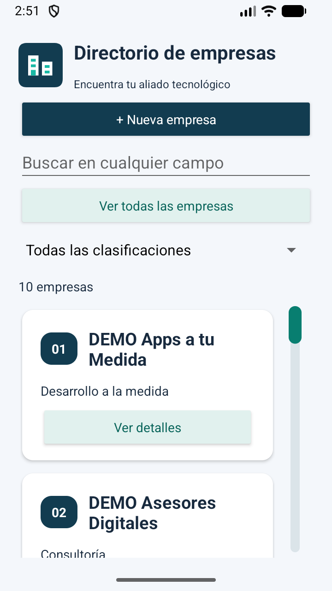
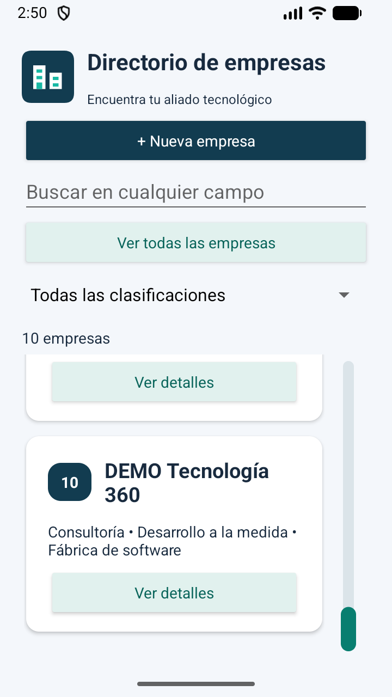

# Desplazamiento persistente · v1.3.1

La barra nativa temporal se reemplazó por un control lateral propio, visible durante todo el recorrido del listado. Su espacio está reservado junto a las tarjetas, por lo que no tapa el texto. El encabezado y los filtros permanecen fijos; la barra desplaza únicamente las empresas.

- Arrastrar el indicador verde mueve el contenido proporcionalmente entre el inicio y el final, sin lanzamiento por inercia desde la barra.
- Pulsar el carril permite ir directamente a otra posición.
- El desplazamiento táctil sobre las tarjetas sigue disponible y actualiza el indicador.
- La posición y longitud del indicador se calculan a partir de la altura real del contenido y del área visible; los cambios de altura de los detalles actualizan la barra.
- Cuando todo el contenido cabe o no hay resultados, el carril permanece visible en gris y no desplaza contenido inexistente.
- Al cambiar la búsqueda o clasificación, se detiene la inercia y el listado vuelve al inicio para mostrar el primer resultado.
- Se incluyen acciones de accesibilidad para avanzar, retroceder y establecer posición, además de las flechas del teclado cuando la barra tiene foco. No se declara una prueba con lector de pantalla.

## Validación del 14 de octubre de 2026

Compilación y lint sin errores. En Small Phone / Android 17 se aprobaron cinco pruebas instrumentadas: tres de base de datos/búsqueda, una de CRUD de interfaz y una nueva de desplazamiento. Esta última arrastra hasta ambos extremos, comprueba la posición exacta, reduce el contenido a una altura inferior al área visible y comprueba que la barra sigue visible sin permitir desplazamiento. Durante su preparación se corrigió la altura mínima del contenido ficticio de la prueba; el resultado final es OK (5 tests).

Además se arrastró visualmente la barra en el emulador integrado de Android Studio desde la empresa 01 hasta la 10 y de regreso a la 01. La app conserva las diez empresas DEMO. Las capturas muestran ambos extremos. La instalación se realizó con adb install -r, sin desinstalación ni cambio de esquema SQLite.

Versión de aplicación: 1.3.1; versionCode: 8. Se conservan los avisos no bloqueantes de lint documentados anteriormente.

[Salida de las pruebas](evidencias/v1.3.1/pruebas.txt)

