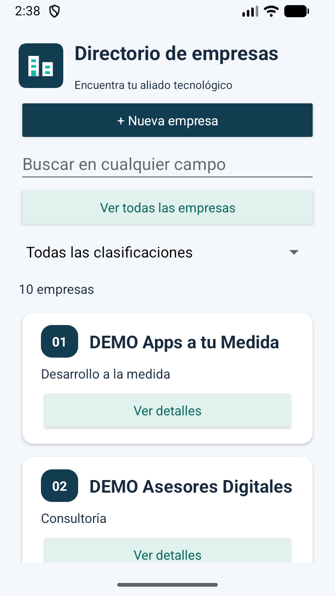
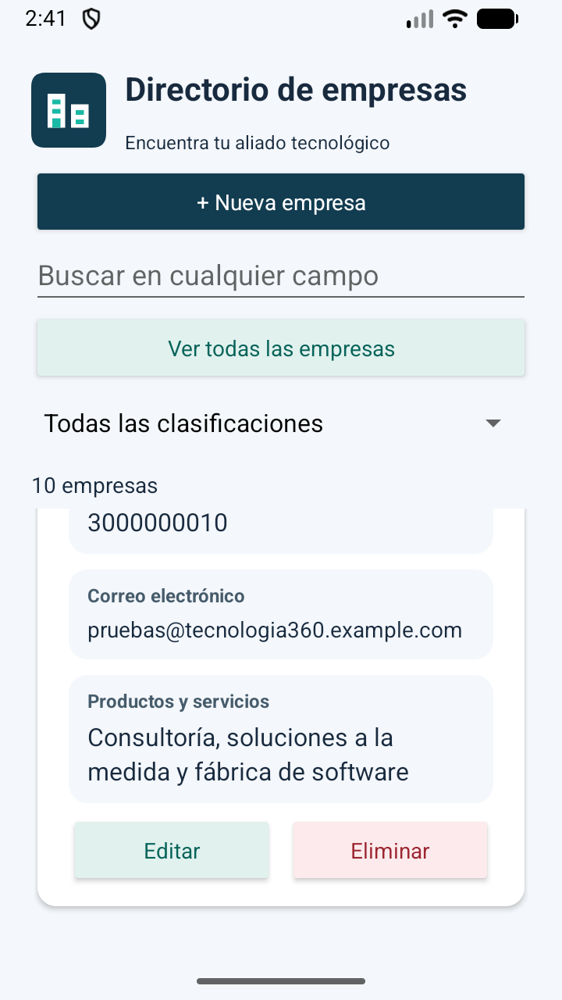

# Detalle y numeración · v1.3.0

El detalle anterior concatenaba etiquetas y datos en un solo bloque de texto, lo que dificultaba distinguir campos y dejaba poco ancho para los correos. Ahora cada dato tiene su propia sección de fondo suave, etiqueta pequeña y valor debajo. Página web y correo usan una tipografía de 14 sp y el resto de valores 16 sp; las tarjetas aprovechan más ancho de pantalla. Los textos siguen siendo seleccionables y los valores largos pueden ocupar varias líneas sin truncarse.

Editar y Eliminar se muestran en una misma fila; Eliminar tiene un tratamiento rojo suave y conserva el diálogo de confirmación.

Las tarjetas llevan una insignia 01, 02, 03… que indica su posición en el listado actual. La numeración se recalcula al buscar, cambiar clasificación, agregar o eliminar. Es una ayuda de lectura, no el identificador persistente de SQLite. El nombre de empresa se mantiene en un texto independiente para su lectura y búsqueda.

## Validación

El 14 de octubre de 2026 se compiló con `assembleDebug lintDebug assembleDebugAndroidTest`, sin errores de lint. Se instalaron los APK mediante `adb install -r` y las cuatro pruebas instrumentadas pasaron en Small Phone / Android 17. Cubren SQLite, búsqueda global, clasificación y CRUD de interfaz, incluida confirmación de eliminación. Tras un ajuste final exclusivamente tipográfico para web y correo se repitieron compilación y lint y se inspeccionó la presentación en el emulador.

Se verificó visualmente la numeración inicial y la empresa número 10, la separación de campos, el correo largo y la fila de acciones. Se conservan las diez empresas DEMO. No se modificó el esquema ni los identificadores de la base de datos.

Versión de la app: 1.3.0; versionCode: 7. Se conservan las advertencias no bloqueantes de lint ya documentadas; las capturas representan el emulador probado, no todos los tamaños de pantalla.

[Resultado de las cuatro pruebas](evidencias/v1.3.0/pruebas.txt)

