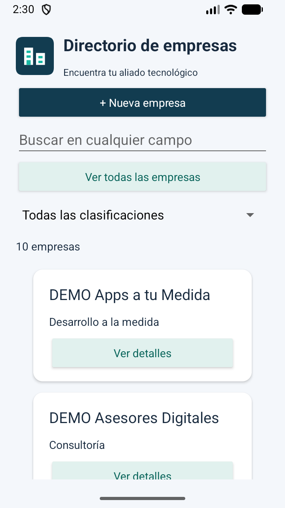

# Logo y mejoras de uso · v1.2.0

El logo representa dos edificios con ventanas verdes sobre un fondo azul oscuro. Se implementó como recurso vectorial nativo de Android, de modo que escala sin perder definición y no agrega dependencias ni descargas. Hay una variante para el encabezado y otra para el icono adaptativo del lanzador.

## Mejoras

- Encabezado con logo y texto orientado al usuario: Encuentra tu aliado tecnológico.
- Botón Nueva empresa destacado en azul oscuro; acciones secundarias en verde claro con texto de contraste.
- Tarjetas blancas con esquinas redondeadas y sombra suave.
- Barra de estado con iconos oscuros sobre fondo claro.
- Datos de contacto seleccionables para copiar desde Ver detalles.
- La tecla Buscar del teclado oculta el teclado; el filtrado continúa ocurriendo mientras se escribe.
- Mensajes distintos para un directorio sin registros y una búsqueda sin coincidencias.
- Contador que muestra 1 empresa o varias empresas, sin la notación empresa(s).

## Validación

El 14 de octubre de 2026 se compiló la aplicación con `assembleDebug lintDebug assembleDebugAndroidTest`. Lint terminó sin errores. Se corrigió durante la validación un atributo de tema que requería API 27 para mantener compatibilidad con minSdk 26; se conservan avisos no bloqueantes documentados en versiones anteriores.

La instalación en Small Phone / Android 17 se hizo con `adb install -r`. Las cuatro pruebas instrumentadas de SQLite, búsqueda global, clasificación y CRUD de interfaz pasaron. Se inspeccionó la pantalla inicial para comprobar el logo, contraste, tarjetas y contador; las diez empresas DEMO siguen presentes. La prueba automatizada cubre la funcionalidad existente; la apariencia se comprobó visualmente en este emulador, no en todos los tamaños de pantalla.

Versión instalada: 1.2.0, versionCode 6. El esquema de SQLite continúa en versión 1.

[Resultado de instrumentación](evidencias/v1.2.0/pruebas.txt)

