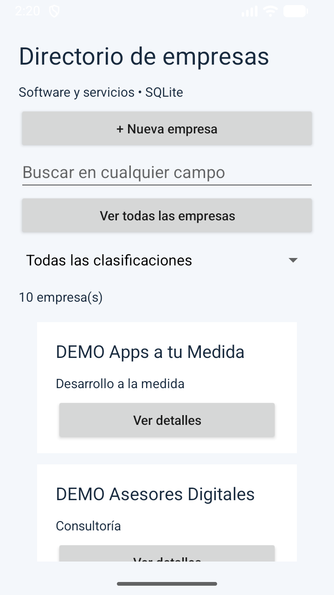

# Listado y búsqueda global · v1.1.0

La pantalla inicial muestra todas las empresas en orden alfabético, con tarjetas compactas de nombre y clasificación. Ver detalles despliega los datos completos y las acciones Editar y Eliminar. Ocultar detalles vuelve a contraer la tarjeta.

Ver todas las empresas borra el texto de búsqueda, selecciona Todas las clasificaciones, oculta el teclado y vuelve al inicio del listado. Permite explorar el directorio sin conocer previamente un nombre.

El buscador consulta nombre, URL, teléfono, email, productos y servicios y los nombres de las clasificaciones. Se buscan fragmentos literales: por ejemplo, `inventario`, `@apps`, un fragmento de teléfono o `consultoria`. No distingue mayúsculas ni tildes. El filtro de clasificación se combina con el texto; una consulta vacía muestra todas las empresas de la clasificación seleccionada. Las consultas no se interpolan como SQL y los símbolos `%` y `_` se tratan literalmente. La selección de categoría se aplica en SQLite y la comparación normalizada de campos en Java, apropiada para este directorio local; no se añadió un índice de búsqueda para grandes volúmenes.

## Validación del 14 de octubre de 2026

- Compilación de APK, APK de pruebas y lint: aprobados, sin errores de lint.
- Instrumentación en Small Phone / Android 17: **OK (4 tests)**.
- Pruebas de creación, consulta, edición, eliminación y persistencia; filtros combinados y caracteres literales; búsqueda en cada campo y sin tildes; recuperación del listado con Ver todas y expansión de detalles.
- Inspección de captura del listado inicial: muestra diez empresas conservadas tras instalar con `adb install -r`.
- Versión de aplicación 1.1.0, versionCode 5; esquema SQLite versión 1.

Se ejecutó la instrumentación directamente mediante ADB para conservar la instalación y los datos. Los registros DEMO permanecen en el emulador; el archivo de la base de datos no se publica en GitHub. Persisten los avisos de lint documentados en versiones anteriores sobre SDK objetivo y extracción de datos.

[Resultado de pruebas](evidencias/v1.1.0/pruebas.txt)

