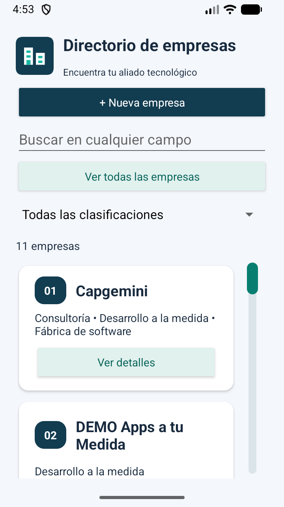
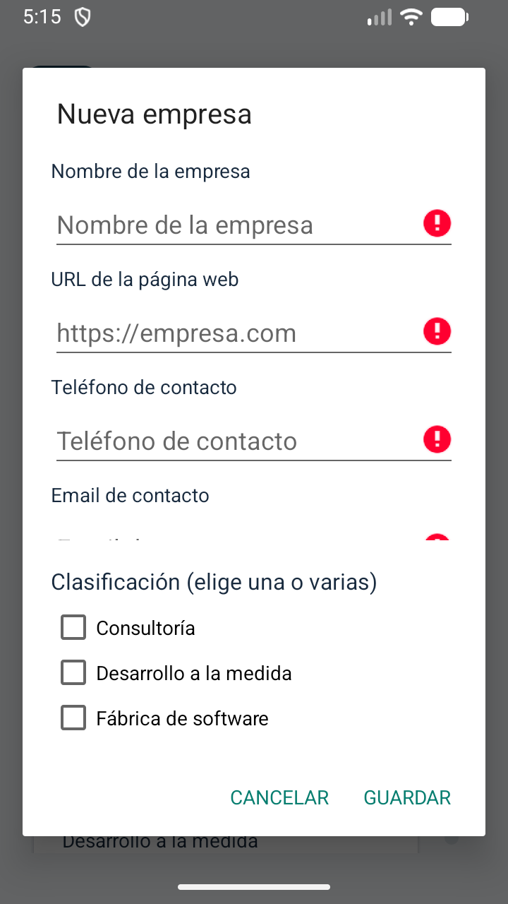
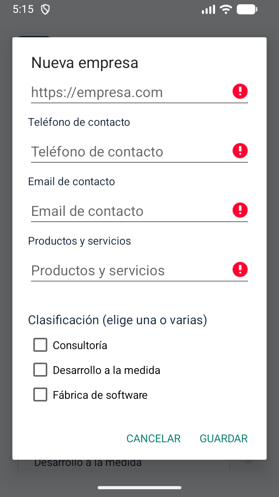
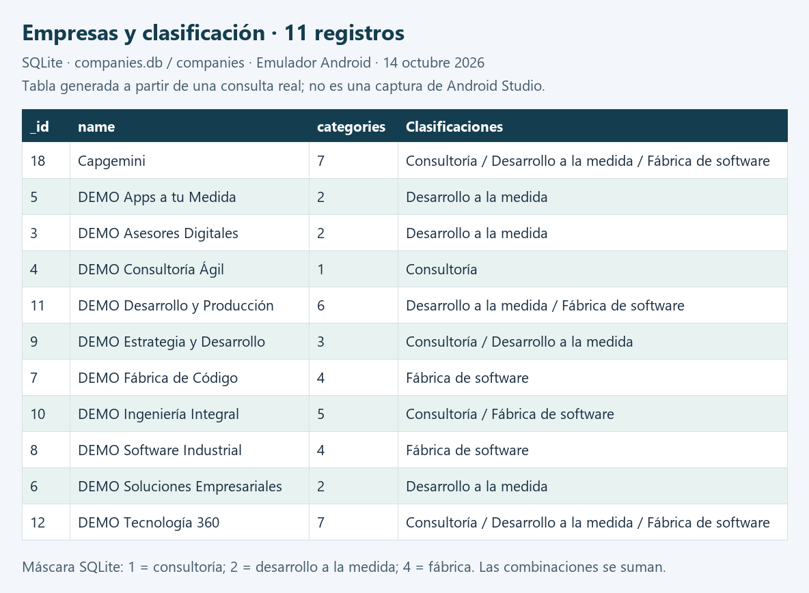
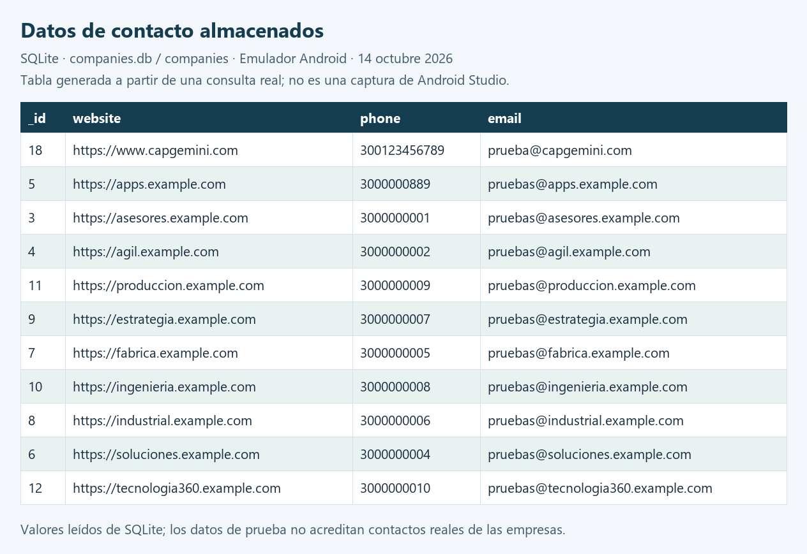
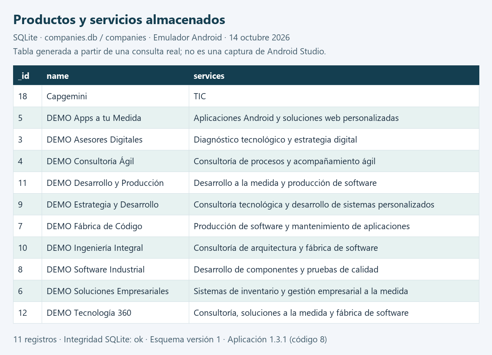

# Pruebas en el emulador · actualizado a v1.3.1

Última actualización: **14 de octubre de 2026**. Se mantiene el nombre de este archivo para conservar el enlace original. La app instalada es **1.3.1 (versionCode 8)**; esta revisión documental se identifica en Git como `docs-v1.3.1-r2`. El informe original v1.0.2 se conserva en un [archivo histórico separado](HISTORICO_PRUEBA_EMULADOR_v1.0.2.md).

## Estado actual y mejoras verificadas

| Entrega | Ajuste | Evidencia de validación |
| --- | --- | --- |
| v1.0.3 | Tres clasificaciones visibles y selección múltiple en el formulario | [Requisitos y prueba de CRUD de interfaz](REQUISITOS_v1.0.3.md) |
| v1.1.0 | Listado compacto, Ver detalles, Ver todas las empresas y búsqueda en cualquier campo sin distinguir tildes o mayúsculas | [Listado y búsqueda](LISTADO_BUSQUEDA_v1.1.0.md) |
| v1.2.0 | Logo, icono, colores, contador y tecla Buscar que oculta el teclado | [Identidad visual](IDENTIDAD_v1.2.0.md) |
| v1.3.0 | Detalles separados por campo, acciones en una fila y numeración de las empresas | [Detalle y numeración](DETALLE_v1.3.0.md) |
| v1.3.1 | Barra lateral persistente, arrastre proporcional, pulsación del carril y retorno al inicio al filtrar | [Desplazamiento y capturas de ambos extremos](DESPLAZAMIENTO_v1.3.1.md) |

La numeración 01, 02… representa la posición en el listado filtrado; no es el identificador `_id` de SQLite. La barra lateral pertenece a la app y permanece visible. La barra flotante con micrófono, lupa y emoji pertenece al teclado de Android: se ocultó mediante Buscar; puede reaparecer al escribir y no supone un defecto del directorio.

### Captura actual de la aplicación

Captura nueva del emulador `emulator-5554`, después de detener y reabrir el proceso para obtener una copia consistente de SQLite. El listado muestra **11 empresas**, logo, búsqueda global, numeración y barra lateral, sin la barra flotante del teclado.



## Evidencias actuales del formulario · v1.3.1

### Campos obligatorios y clasificación

Prueba visual realizada el 14 de octubre de 2026 sobre la app instalada v1.3.1: se abrió **Nueva empresa** y se pulsó **Guardar** sin completar los campos ni elegir clasificación. El formulario permaneció abierto, mostró indicadores de error y el aviso «Selecciona al menos una clasificación». Las tres opciones están visibles en el bloque fijo inferior.



### Campos inferiores y productos y servicios

Al desplazar únicamente el área de datos aparecen Email y Productos y servicios con sus indicadores de error. Las casillas Consultoría, Desarrollo a la medida y Fábrica de software permanecen visibles. Los cinco campos se reparten entre estas dos capturas por la altura del emulador.



Se pulsó **Cancelar** al finalizar. El listado siguió mostrando once empresas; esta prueba no creó ni eliminó registros. La comprobación de confirmación y cancelación de eliminación está cubierta por la prueba instrumentada de interfaz citada abajo; no queda pendiente como indicaba el informe antiguo.

### Pruebas de la versión vigente

La validación previa de v1.3.1 finalizó con compilación y lint sin errores y **cinco pruebas instrumentadas aprobadas**, según la [salida conservada del ejecutor](evidencias/v1.3.1/pruebas.txt). Cubre CRUD y persistencia, filtros, búsqueda global, CRUD de interfaz con cancelación y confirmación de eliminación, y desplazamiento hasta ambos extremos con reducción posterior del contenido. El [informe de desplazamiento](DESPLAZAMIENTO_v1.3.1.md) detalla el recorrido visual de inicio a final y regreso.

En esta actualización documental se verificaron nuevamente la versión instalada, la lectura de SQLite, la integridad de la copia, el listado tras reabrir la app y la validación visual del formulario vacío con sus tres clasificaciones visibles. No se recompiló ni se repitió la suite instrumentada, porque no se modificó código. Se conservan las limitaciones de un único emulador y las advertencias no bloqueantes de lint.

## SQLite con los datos actuales

Origen: `com.hernandovela.reto8/databases/companies.db`, tabla `companies`, esquema versión 1. Se extrajo una copia con `adb exec-out run-as` después de detener la app y se consultó localmente en modo de solo lectura. La app se volvió a abrir sin borrar ni modificar registros.

La copia contiene **11 registros: diez DEMO y Capgemini**. Los valores reproducen el estado actual, incluidas las ediciones hechas después de la carga inicial; no se sustituyeron por los datos originales. Son datos usados en pruebas y no deben interpretarse como un directorio de contactos comerciales verificados.

| Verificación | Resultado |
| --- | --- |
| `PRAGMA integrity_check` | `ok` |
| Total de empresas | 11 |
| Pertenecen a Consultoría (`categories & 1`) | 5 |
| Pertenecen a Desarrollo a la medida (`categories & 2`) | 7 |
| Pertenecen a Fábrica de software (`categories & 4`) | 6 |

Los conteos por clasificación se superponen: una empresa puede pertenecer a varias. `categories` guarda una máscara: 1 = consultoría, 2 = desarrollo a la medida, 4 = fábrica; por ejemplo, 7 incluye las tres.

### Empresas y clasificaciones

Las siguientes imágenes son **tablas generadas a partir de consultas reales sobre la copia de SQLite**, no capturas del inspector de Android Studio. En conjunto muestran los siete campos almacenados de los once registros.



### Páginas web, teléfonos y correos



### Productos y servicios



Se adjuntan los [registros consultados en CSV](evidencias/sqlite-v1.3.1/registros.csv), las [consultas y definición de la tabla](evidencias/sqlite-v1.3.1/consulta.sql) y la [verificación con huella SHA-256 de la copia](evidencias/sqlite-v1.3.1/verificacion.json). La copia binaria de la base no se incorpora al repositorio ni se incluye como precarga del APK.

Para reproducir las consultas desde Database Inspector, abrir la app de depuración en el emulador, conectar su proceso, seleccionar `companies.db` y ejecutar:

```sql
SELECT _id, name, website, phone, email, services, categories
FROM companies
ORDER BY name COLLATE NOCASE, _id;

SELECT COUNT(*) AS total,
       SUM((categories & 1) != 0) AS consultoria,
       SUM((categories & 2) != 0) AS desarrollo,
       SUM((categories & 4) != 0) AS fabrica
FROM companies;
```

Los resultados cambiarán si se crean, editan o eliminan empresas después de esta captura.
