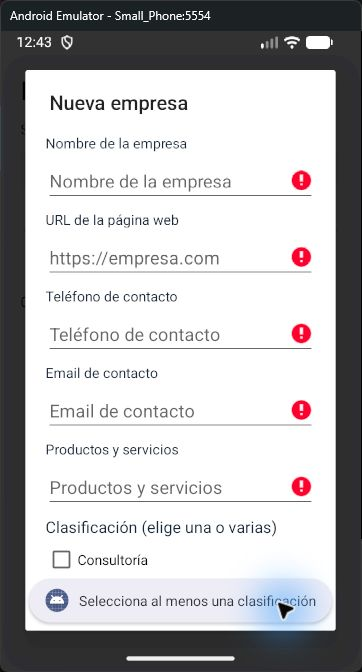
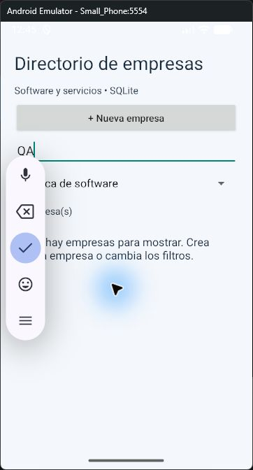
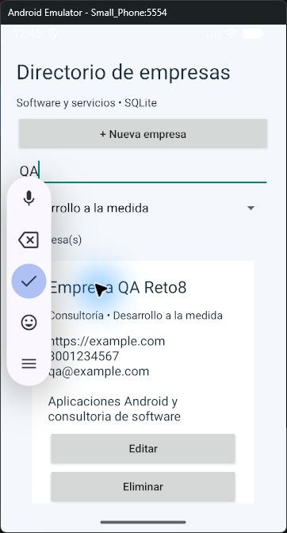
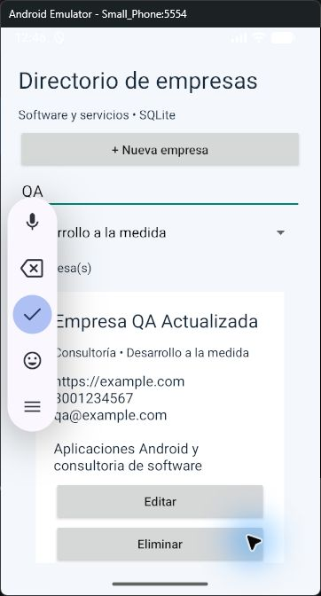
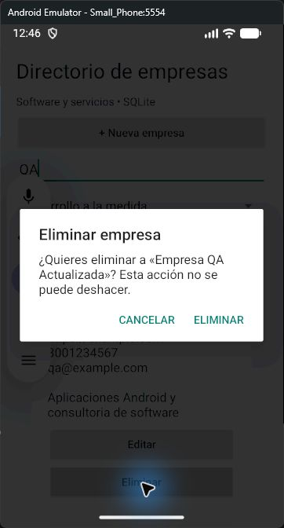
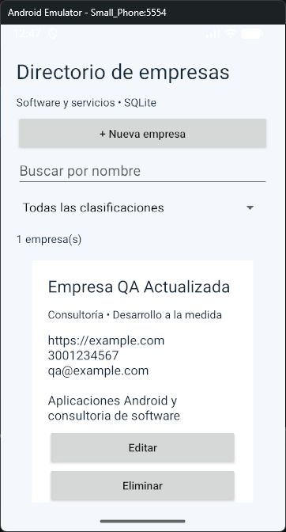
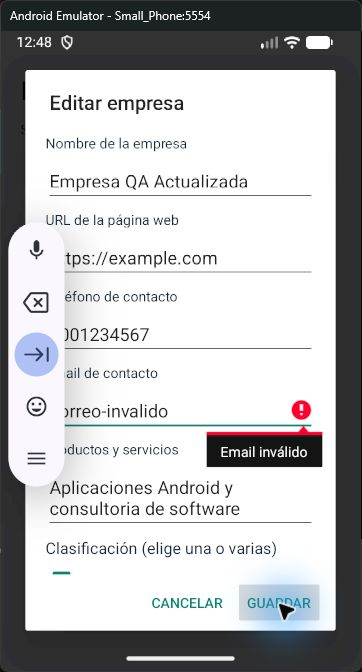
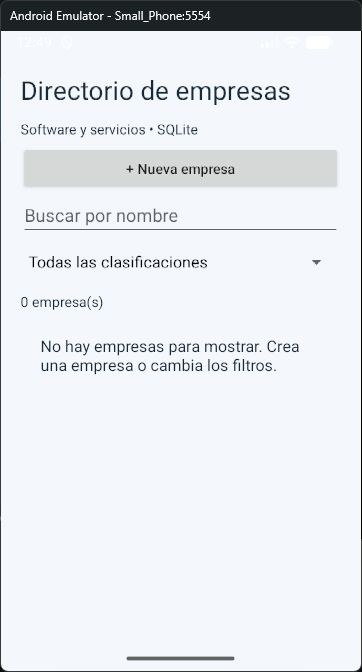

# Prueba en el emulador · entrega v1.0.2

## Entorno y alcance

Prueba realizada el 13 de octubre de 2026, zona horaria America/Bogota, en el emulador Android de la PC: `Small_Phone`, identificador `emulator-5554`, Android 17 (API 37). El recorrido visual se realizó sobre el APK v1.0.1 y se entrega como v1.0.2 con esta evidencia; la lógica funcional y el esquema de SQLite se conservan. El reloj de la barra del emulador puede diferir del reloj local de la PC.

Se controló la ventana del emulador mediante la habilidad Computer Use: clics, escritura, desplazamiento y lectura de pantalla. Para comprobar persistencia se reinició el proceso con Android Debug Bridge, sin borrar datos. Las imágenes contienen la ventana del emulador; la barra flotante del teclado de Android aparece en algunas capturas y no forma parte de la aplicación.

## Datos ficticios

| Campo | Valor |
| --- | --- |
| Nombre inicial | Empresa QA Reto8 |
| Nombre después de editar | Empresa QA Actualizada |
| URL | https://example.com |
| Teléfono ficticio | 3001234567 |
| Email | qa@example.com |
| Productos y servicios | Aplicaciones Android y consultoria de software |
| Clasificaciones | Consultoría y Desarrollo a la medida |

## Casos ejecutados y resultados observados

| Caso | Acción | Resultado observado | Estado |
| --- | --- | --- | --- |
| UI-01 | Abrir Nueva empresa y pulsar Guardar con campos vacíos | El formulario permanece abierto, marca errores y solicita al menos una clasificación | Aprobado |
| UI-02 | Completar los cinco campos, seleccionar dos clasificaciones y guardar | Aparece una empresa con los datos ingresados, ambas clasificaciones y mensaje Empresa guardada | Aprobado |
| UI-03 | Buscar QA y filtrar Fábrica de software | No aparecen empresas; mensaje de lista vacía | Aprobado |
| UI-04 | Mantener QA y seleccionar Desarrollo a la medida | Aparece la empresa con sus datos; ambos filtros se aplican juntos | Aprobado |
| UI-05 | Editar el nombre a Empresa QA Actualizada y guardar | Se actualiza la tarjeta existente y no se duplica el registro | Aprobado |
| UI-06 | Pulsar Eliminar | Aparece el diálogo con el nombre de la empresa y botones Cancelar y Eliminar | Aprobado |
| UI-07 | Pulsar Cancelar en el diálogo | La empresa permanece en el listado | Aprobado |
| UI-08 | Detener completamente el proceso y volver a abrir la aplicación | Se conserva el nombre editado, URL, teléfono, email, servicios y ambas clasificaciones; aparece una empresa | Aprobado |
| UI-09 | Editar el email a correo-invalido y pulsar Guardar | El formulario rechaza el valor con Email inválido; al cancelar, permanece qa@example.com | Aprobado |

La confirmación final de eliminación no se pulsó mediante control de Windows. Se solicitó autorización por la política de la habilidad Computer Use, pero no se recibió durante el recorrido. La eliminación de registros sí se verificó mediante la prueba instrumentada `testCrudAndPersistence`. La limpieza posterior del ejecutor de pruebas desinstaló la aplicación y su registro ficticio; esa limpieza no constituye una prueba del botón Eliminar. Al finalizar se reinstaló y abrió v1.0.2, con el directorio vacío.

## Evidencias

### Campos obligatorios y clasificación



### Filtros combinados sin coincidencias



### Filtros combinados con coincidencia



### Edición guardada



### Confirmación antes de eliminar



### Persistencia tras reiniciar el proceso



### Email inválido rechazado



### Entrega v1.0.2 reinstalada



## Validación automatizada de la entrega

`gradlew.bat assembleDebug lintDebug connectedDebugAndroidTest` finalizó con `BUILD SUCCESSFUL`. El reporte [JUnit original](evidencias/junit-v1.0.2.xml) registra dos pruebas, cero fallos, cero errores y cero pruebas omitidas. Su marca de tiempo usa UTC: `2026-10-14T00:49:08`, equivalente al 13 de octubre de 2026 a las 19:49:08 en Colombia.

| Prueba | Resultado |
| --- | --- |
| testCrudAndPersistence | Aprobada |
| testCombinedAndLiteralFilters | Aprobada |

Lint finalizó sin errores; conserva advertencias de SDK objetivo 36 y configuración de extracción de datos. La verificación de GitHub Actions es independiente de estos resultados locales.

## Reproducción

1. Instalar el APK y abrir Directorio de empresas.
2. Ejecutar las acciones UI-01 a UI-09 de la tabla con los datos ficticios.
3. Para repetir la comprobación de persistencia, ejecutar los siguientes comandos con el emulador conectado.

```powershell
adb shell am force-stop com.hernandovela.reto8
adb shell am start -n com.hernandovela.reto8/.MainActivity
```

## Límites de esta evidencia

El recorrido cubre un emulador, una empresa y dos clasificaciones. La cancelación de eliminación se verificó visualmente. Las pruebas instrumentadas complementan el recorrido con creación, consulta, actualización, eliminación y persistencia al reabrir SQLite, además de búsquedas literales y parametrizadas; usan una base de prueba independiente. No se declara una validación en dispositivos físicos ni una revisión de todos los tamaños de pantalla.
