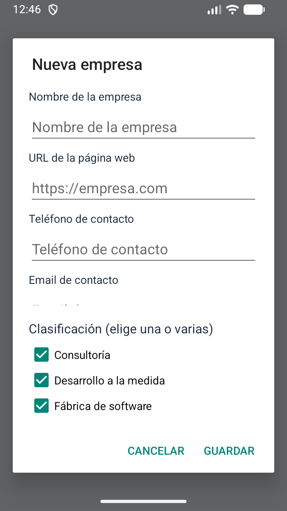
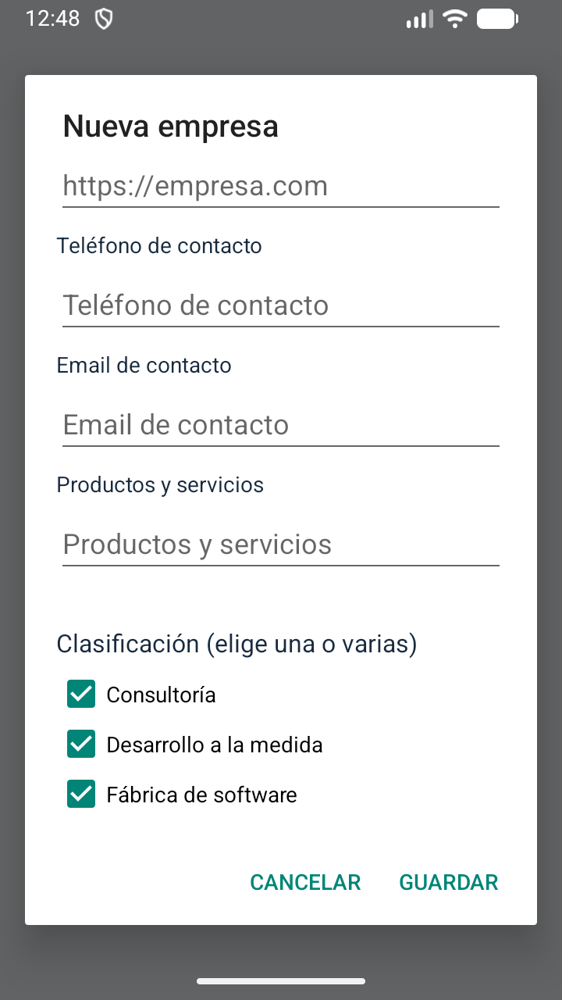
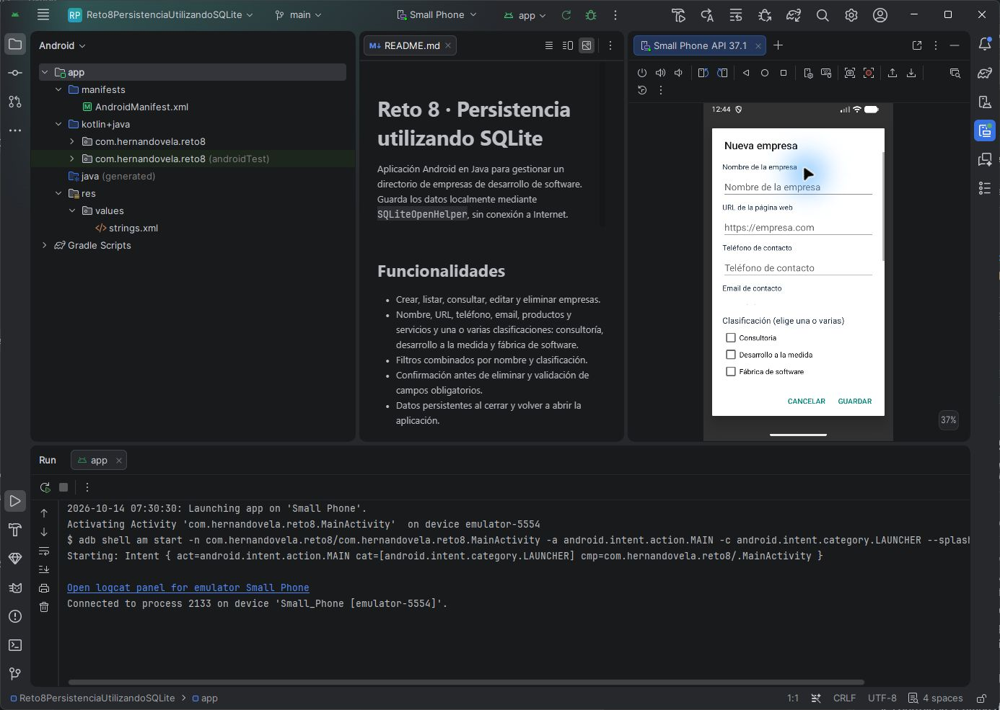

# Rectificación de requisitos · v1.0.3

Revisión y pruebas realizadas el 14 de octubre de 2026 en el proyecto local de Android Studio y el emulador Small Phone, Android 17 / API 37. La app instalada tiene `versionName = 1.0.3` y `versionCode = 4`. SQLite mantiene la versión 1: esta corrección no cambia las tablas ni requiere borrar datos.

## Problema identificado en la captura

La app ya contenía Consultoría, Desarrollo a la medida y Fábrica de software, con selección múltiple y persistencia. Sin embargo, el formulario anterior colocaba las casillas dentro del mismo ScrollView que los campos. En pantallas pequeñas solo aparecía Consultoría hasta desplazar el contenido. Esa presentación dificultaba descubrir las otras dos opciones.

Se corrigió el diálogo compartido por Nueva empresa y Editar empresa: los cinco campos permanecen en un área desplazable y las tres clasificaciones se muestran en un bloque fijo debajo. El diálogo aprovecha el 90 % de la altura de pantalla y ajusta el espacio al teclado. Los campos inferiores, incluido Productos y servicios, se alcanzan deslizando el área de datos; las clasificaciones permanecen visibles. La corrección se verificó en el emulador indicado; no se declara validación de todos los tamaños de pantalla o escalas de fuente.

## Matriz de cumplimiento

| Requisito del reto | Implementación | Verificación |
| --- | --- | --- |
| Persistencia mediante SQLite | CompanyDatabase utiliza SQLiteOpenHelper y tabla companies | Prueba CRUD y reapertura de SQLite aprobada |
| Nombre de la empresa | Campo name en formulario y tabla | Creación, consulta y edición aprobadas |
| URL de la página web | Campo website con validación HTTP/HTTPS | Conservación del valor comprobada en prueba de base de datos |
| Teléfono | Campo phone | Conservación del valor comprobada en prueba de base de datos |
| Email | Campo email con validación de formato | Conservación del valor comprobada; validación visual documentada en v1.0.2 |
| Productos y servicios | Campo services, accesible desplazando los campos | Conservación del valor comprobada y captura del campo visible |
| Consultoría, desarrollo a la medida y/o fábrica de software | Tres casillas independientes; máscara de bits 1, 2 y 4 admite combinaciones 1 a 7 | Prueba de interfaz verifica visibilidad completa de las tres casillas, las selecciona y comprueba que SQLite almacena 7 |
| Crear empresas | Formulario Nueva empresa y operación insert | Prueba de interfaz crea una empresa ficticia y verifica el listado |
| Consultar/listar empresas | Tarjetas con todos los datos y clasificación | Pruebas de consulta y listado aprobadas |
| Actualizar empresas | Formulario precargado y operación update por identificador | Prueba de interfaz cambia el nombre y comprueba la tarjeta actualizada |
| Eliminar empresas | Operación delete por identificador | Prueba de interfaz confirma y verifica ausencia en pantalla y SQLite |
| Filtrar por nombre y/o clasificación | Búsqueda textual y selector; se combinan mediante AND | Pruebas de filtros combinados, nombre, clasificación y búsqueda literal aprobadas; recorrido visual previo en v1.0.2 |
| Mensaje para confirmar eliminación | Diálogo con nombre de empresa, Cancelar y Eliminar | Prueba de interfaz verifica el mensaje, cancela y comprueba conservación; después confirma y comprueba eliminación |

El enlace a Tutorialspoint del enunciado es material de apoyo. Los requisitos funcionales revisados son los copiados por el usuario; no se agregaron funciones externas al reto.

## Pruebas de la entrega

Compilación y análisis: `gradlew.bat assembleDebug lintDebug assembleDebugAndroidTest`, resultado `BUILD SUCCESSFUL`; lint sin errores. Permanecen avisos de SDK objetivo 36 y configuración de extracción de datos, documentados en las entregas anteriores.

Se instalaron ambos APK con `adb install -r` y se ejecutó la instrumentación directamente, evitando la desinstalación automática de Gradle al terminar. Resultado final: **OK (3 tests)**. El primer intento de la nueva prueba necesitó ajustar la espera del evento asíncrono de confirmación del diálogo de Android; después de esperar a que la interfaz quedara inactiva, la prueba pasó.

| Prueba | Cobertura | Resultado |
| --- | --- | --- |
| CompanyDatabaseTest.testCrudAndPersistence | Campos, creación, actualización, eliminación y reapertura de SQLite | Aprobada |
| CompanyDatabaseTest.testCombinedAndLiteralFilters | Filtros combinados y búsquedas literales/parametrizadas | Aprobada |
| RequirementsUiTest.classificationsAndCrudMeetRequirements | Tres clasificaciones completamente visibles, selección múltiple, CRUD y diálogo de eliminación | Aprobada |

La prueba de interfaz utiliza un nombre único con prefijo QA-Requisitos y elimina únicamente el registro que crea. Las pruebas de base de datos utilizan companies-test.db. Se verificó visualmente el formulario real en el emulador integrado de Android Studio, se seleccionaron las tres casillas y se desplazaron los campos hasta Productos y servicios.

Resultado original de instrumentación: [pruebas-instrumentadas.txt](evidencias/v1.0.3/pruebas-instrumentadas.txt).

```powershell
.\gradlew.bat assembleDebug lintDebug assembleDebugAndroidTest
adb install -r app/build/outputs/apk/debug/app-debug.apk
adb install -r app/build/outputs/apk/androidTest/debug/app-debug-androidTest.apk
adb shell am instrument -w com.hernandovela.reto8.test/androidx.test.runner.AndroidJUnitRunner
```

## Evidencia visual

Las tres clasificaciones se pueden seleccionar simultáneamente sin desplazar su bloque:



Productos y servicios se alcanza desplazando los campos; las clasificaciones continúan visibles:



Vista del proyecto correcto y emulador en Android Studio:


